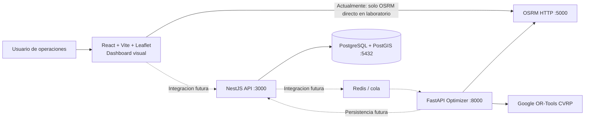

# RouteFlow SaaS - Cuaderno de contexto para IA

> Informe tecnico generado a partir del estado actual del repositorio. Fecha de referencia: 2026-10-15.
>
> Este documento distingue entre codigo implementado, contratos declarados y funcionalidades planificadas. No incluye contrasenas, tokens, claves, URLs privadas ni contenido de archivos `.env`.

## 1. Resumen ejecutivo

RouteFlow es una plataforma SaaS de ultima milla para planificar y supervisar rutas de reparto. El objetivo de negocio es resolver un Vehicle Routing Problem (VRP) para varios vehiculos, considerando capacidades de carga, ubicaciones, tiempos de servicio y ventanas horarias, con distancias y duraciones basadas en la red vial real mediante OSRM.

El repositorio contiene tres piezas principales:

- `frontend/`: aplicacion React + Vite con un dashboard visual, navegacion entre vistas, datos mock y un laboratorio funcional para consultar/visualizar respuestas de OSRM.
- `backend/`: API NestJS inicial. Actualmente expone una respuesta de bienvenida y un health check de PostgreSQL/PostGIS; aun no implementa el dominio SaaS.
- `optimizer/`: servicio FastAPI independiente que consulta matrices OSRM y ejecuta un solver CVRP con Google OR-Tools.
- `database/`: esquema SQL inicial para PostgreSQL + PostGIS, con soporte multi-tenant y entidades de usuarios, flota, entregas, optimizaciones, rutas y eventos.

La infraestructura Docker ya describe el despliegue local de PostgreSQL/PostGIS, OSRM, el optimizador, NestJS y el frontend servido por Nginx. La integracion efectiva entre frontend, backend, base de datos y optimizador todavia esta incompleta.

## 2. Estado actual en una frase

El nucleo algoritmico VRP/OSRM esta implementado y probado de forma aislada; el backend de negocio, la persistencia, la autenticacion, las colas y el tiempo real aun son principalmente contratos, esquema o interfaz visual.

## 3. Tecnologias efectivamente presentes

### Frontend

- React 19.
- TypeScript 6.
- Vite 8.
- Tailwind CSS 4 mediante plugin de Vite.
- Leaflet 1.9 y React Leaflet 5.
- Lucide React para iconos.
- ESLint y TypeScript como herramientas de validacion.
- Nginx Alpine para servir el build en Docker.

### Backend

- Node.js 24 Alpine en la imagen Docker.
- NestJS 12.
- TypeScript 6.
- Express mediante `@nestjs/platform-express`.
- `@nestjs/config` para variables de entorno.
- TypeORM y `pg` para conexion PostgreSQL.
- Vitest, Supertest y cobertura V8 para pruebas.
- Oxlint para linting.

### Optimizador

- Python 3.12-slim en Docker; el codigo es compatible con Python 3.10+ segun la documentacion local.
- FastAPI y Uvicorn.
- Pydantic y Pydantic Settings.
- HTTPX para consultar OSRM.
- Google OR-Tools para el modelo de ruteo.
- Pytest declarado en dependencias de desarrollo/prueba.

### Infraestructura y datos

- Docker Compose.
- PostgreSQL 16 con PostGIS 3.4 mediante `postgis/postgis:16-3.4`.
- OSRM Backend con perfil de conduccion `car`.
- Datos cartograficos de Geofabrik, por defecto Colombia; existe un compose alternativo para recortar una zona, por defecto Cali y alrededores.
- Volumenes Docker persistentes para PostgreSQL y datos procesados de OSRM.
- CodeGraph 1.6.1 instalado como dependencia de desarrollo y un indice `.codegraph/` presente en el repositorio.

## 4. Arquitectura actual

### Flujo que funciona hoy en el optimizador

1. `POST /optimize` recibe bodega, vehiculos, entregas y limite opcional de tiempo.
2. Valida coordenadas, ids unicos, capacidades, pesos y ventanas mediante Pydantic.
3. Consulta `/table/v1/driving/...` de OSRM para obtener matrices NxN de duracion y distancia.
4. Rechaza respuestas OSRM invalidas, puntos sin ruta o errores HTTP/red con respuesta 502.
5. Ejecuta OR-Tools fuera del event loop de FastAPI usando `run_in_threadpool`.
6. Devuelve rutas cerradas en la bodega, carga total, distancia, duracion y entregas no asignadas.

### Flujo que no esta conectado aun

- El frontend no llama al backend para login, signup, dashboard, flota, entregas ni optimizacion.
- El backend no tiene un cliente HTTP para `OPTIMIZER_URL`.
- No existe cola Redis/BullMQ/Celery implementada.
- No existe gateway WebSocket o Socket.IO implementado.
- No hay repositorios, entidades TypeORM ni servicios de dominio para el esquema SQL.
- No se persisten solicitudes ni resultados del optimizador.

## 5. Backend NestJS: alcance real

### Modulos y rutas presentes

`AppModule` importa `ConfigModule` global y `DatabaseModule`.

Rutas actuales:

- `GET /`: devuelve exactamente `Hello World!`.
- `GET /health/db`: consulta `pg_extension` y devuelve `{ status: "ok", postgis: ... }`; si falla, responde 503.

`DatabaseModule` configura TypeORM para PostgreSQL usando `DATABASE_URL`, SSL opcional, CA opcional y pool configurable. `synchronize` esta desactivado: el esquema debe aplicarse desde `database/schema.sql`.

### Lo que falta en backend

- Autenticacion JWT real, refresh tokens, roles y guards.
- Resolucion del tenant desde el usuario autenticado.
- CRUD de empresas, usuarios, bodegas, vehiculos, entregas y rutas.
- Importacion CSV/Excel con validacion por fila.
- Cliente/orquestador NestJS -> optimizador.
- Colas y trabajos asincronos.
- Persistencia de `optimization_runs`, `routes` y `route_stops`.
- Eventos de estado de entregas.
- CORS, validacion global, versionado de API y contratos DTO completos.
- Observabilidad, logging estructurado y manejo de errores de negocio.

## 6. Optimizador Python: alcance real

### Contrato de entrada

`OptimizeRequest` contiene:

- `depot`: id y coordenadas lat/lon.
- `vehicles`: lista no vacia; cada vehiculo tiene id y capacidad positiva en kg.
- `deliveries`: lista no vacia; cada entrega tiene id, coordenadas, peso y tiempo de servicio.
- Ventana opcional por entrega: `time_window_start` y `time_window_end` en segundos desde el inicio de la ruta.
- `solver_time_limit_seconds`: opcional, entre 1 y 120 segundos.

Se fuerzan ids unicos de vehiculos y entregas. Se validan rangos geograficos y que el fin de una ventana no sea anterior al inicio.

### Modelo implementado

- Problema base: CVRP con varios vehiculos y deposito comun.
- Costo de arco: duracion de viaje mas tiempo de servicio del nodo de origen del arco.
- Dimension `Time` con horizonte de 24 horas.
- Dimension `Capacity` en kg.
- Ventanas de tiempo opcionales aplicadas a cada entrega.
- Entregas no asignables permitidas mediante una penalizacion alta.
- Estrategia inicial: `PATH_CHEAPEST_ARC`.
- Busqueda local: `GUIDED_LOCAL_SEARCH`.
- Limite de tiempo configurable.
- Vehiculos sin entregas no aparecen en la respuesta.

### Respuesta

`OptimizeResponse` devuelve:

- `status`.
- `message`.
- `routes[]` con vehiculo, secuencia de ids, distancia, duracion y carga.
- `unassigned_delivery_ids[]`.

### Limites y observaciones

- El esquema SQL habla de peso y volumen, pero el solver actual solo calcula capacidad en kg; no existe dimension volumetrica en el contrato Python.
- La respuesta explica que hay entregas no asignadas, pero no devuelve una causa individual por entrega.
- Las matrices se calculan antes de llamar al solver y estan limitadas por `MAX_LOCATIONS`, por defecto 100 puntos incluyendo bodega.
- No hay autenticacion en el servicio FastAPI.
- No hay persistencia, cola ni versionado de resultados.
- Hay tests unitarios para asignacion completa y exceso de capacidad. No se observaron tests para OSRM, ventanas, tiempos de servicio, ids invalidos, matrices con `null`, limite de ubicaciones o errores HTTP.

## 7. Base de datos y modelo de dominio

El archivo `database/schema.sql` define PostgreSQL + PostGIS. La mayoria de tablas incluyen `company_id`, por lo que el diseño pretende aislamiento multi-tenant a nivel de aplicacion.

### Entidades

- `companies`: empresas/tenants.
- `users`: usuarios con roles `admin`, `dispatcher` y `driver`; incluye `password_hash`, pero no se implementa autenticacion en NestJS.
- `warehouses`: bodegas con latitud, longitud y geometria PostGIS generada.
- `vehicles`: placa, capacidad en kg, estado y conductor habitual.
- `csv_imports`: auditoria de cargas masivas y errores por fila.
- `deliveries`: cliente, direccion, coordenadas, estado de geocodificacion, peso, fecha, ventana horaria y estado.
- `optimization_runs`: request/response JSON, estado, error y duracion.
- `routes`: una ruta por vehiculo y fecha, vinculable a una ejecucion de optimizacion.
- `route_stops`: orden de visitas y ETA relativa.
- `delivery_events`: historial temporal de estados de entrega.

### Restricciones y capacidades DB

- PostGIS habilitado.
- Tipos enum para roles, estados de vehiculo, geocodificacion, entregas, rutas y optimizacion.
- Validaciones de latitud, longitud, pesos, capacidades y ventanas.
- Indices por tenant, fecha, estado, vehiculo y conductor.
- Indice espacial GIST para entregas.
- Geometrias generadas automaticamente desde longitud/latitud.
- Triggers `updated_at` en empresas, usuarios, bodegas, vehiculos, entregas y rutas.
- `gen_random_uuid()` se usa para ids UUID; la imagen de PostgreSQL/PostGIS debe soportar la funcion requerida.

### Diferencia entre DB y runtime

El modelo de datos es considerablemente mas completo que el runtime NestJS. Actualmente no hay entidades TypeORM ni migraciones; el SQL es un esquema inicial que debe ejecutarse manualmente o integrarse en un mecanismo de migraciones antes de considerarlo parte del ciclo de despliegue automatizado.

## 8. Frontend: alcance real

### Shell y navegacion

`App.tsx` mantiene el estado de pantalla en memoria y ofrece estas vistas:

- Login.
- Signup.
- Dashboard.
- Planner VRP.
- Live tracking.
- OSRM Lab.
- Fleet.
- Shipments.
- Analytics.
- Settings.

Hay `Sidebar`, `TopNavbar`, tema claro/oscuro y diseño responsive. La navegacion no usa router; es un selector de vista local.

### Componentes y datos

- Dashboard con KPIs, graficas, tabla de rutas y preview de mapa.
- Planner con selector visual de algoritmo, lista mock de vehiculos/paradas, condiciones y boton de ejecucion.
- Vistas de flota, envios, analitica y configuracion.
- Datos principales en `frontend/src/data/mockData.ts`.
- Tipos de UI en `frontend/src/types/index.ts`.
- El dashboard usa estadisticas, rutas, vehiculos y paradas simuladas.

### Integracion real

La unica llamada HTTP encontrada en el frontend es `OsrmLabView`, que permite consultar un endpoint OSRM y parsear:

- `routes[0].geometry.coordinates` para representar una ruta.
- `sources` y `destinations` para representar puntos de una matriz.

El laboratorio convierte coordenadas OSRM de `[lon, lat]` a `[lat, lon]` para Leaflet, muestra distancia/duracion cuando estan disponibles y gestiona errores de JSON o red.

### Funcionalidades visuales que aun son simulacion

- Login y signup solo esperan un `setTimeout` y cambian de vista.
- El usuario se carga desde `mockCurrentUser`.
- El boton de demo rellena credenciales ficticias y entra sin backend.
- `PlannerView` muestra una ejecucion simulada y un `alert` tras 1.5 segundos.
- El boton de exportacion del dashboard solo muestra un `alert`.
- Live tracking, flota, envios, analiticas y settings no consumen API real.
- La subida CSV no tiene input/procesamiento backend conectado.
- El drag-and-drop, la telemetria GPS, las capas por vehiculo y la actualizacion en tiempo real no estan implementados como flujo de datos.

## 9. Infraestructura Docker

### Compose principal

`docker-compose.yml` define:

1. `postgres`: PostgreSQL/PostGIS en el puerto local 5432.
2. `osrm-download`: descarga el mapa PBF si no existe.
3. `osrm-prepare`: ejecuta `osrm-extract`, `osrm-partition` y `osrm-customize`.
4. `osrm`: servidor OSRM en el puerto 5000.
5. `optimizer`: FastAPI en el puerto 8000.
6. `backend`: NestJS en el puerto 3000.
7. `frontend`: build Vite servido por Nginx en el puerto 5173.

El backend recibe `DATABASE_URL`, `OPTIMIZER_URL`, `FRONTEND_URL` y `JWT_SECRET` a traves de configuracion de Compose, pero que una variable exista no significa que su funcionalidad este implementada.

### Compose alternativo OSRM

`docker-compose.osrm.yml` permite descargar el mapa de Colombia, recortarlo con `OSRM_BBOX`, preprocesarlo y exponer solo OSRM. Es util para desarrollo geografico acotado, especialmente Cali y alrededores.

### Imagenes

- Backend: build multi-stage, dependencias de produccion separadas y usuario no root.
- Frontend: build multi-stage y Nginx Alpine.
- Optimizador: imagen Python slim, usuario no root y healthcheck `/health`.

## 10. Pruebas y evidencia de validacion

Validaciones ejecutadas durante la elaboracion de este informe:

| Componente | Resultado |
|---|---|
| Backend `pnpm test` | Pasa: 1 archivo y 1 prueba |
| Backend `pnpm run build` | Pasa |
| Frontend `pnpm build` | Pasa; Vite advierte que el bundle JS minificado supera 500 kB |
| Optimizador `python -m pytest -q` | No ejecutable en el entorno actual: el Python disponible no tiene `pytest` instalado |
| Git working tree | Limpio al momento de la comprobacion |

La suite backend actual solo prueba `GET /` y no cubre el health check de DB ni dominio de negocio. La suite del optimizador declara Pytest y contiene dos pruebas de `solve_vrp`, pero requiere instalar las dependencias de `optimizer/requirements.txt` en el entorno Python usado.

## 11. Estado por requisito

### Implementado

- Servicio FastAPI con `/health` y `/optimize`.
- Integracion OSRM para matrices de duracion/distancia.
- Solver OR-Tools para CVRP con capacidad en kg.
- Soporte de ventanas y tiempos de servicio en el solver Python, aunque no esta integrado al producto.
- Penalizacion para entregas no asignadas.
- Esquema PostgreSQL/PostGIS multi-tenant inicial.
- Health check NestJS de PostgreSQL/PostGIS.
- Shell visual React/Vite responsive.
- Laboratorio frontend para consultar y visualizar OSRM.
- Compose y Dockerfiles para levantar el conjunto local.
- Tests basicos del solver y tests basicos del backend.

### Parcial o simulado

- Autenticacion: UI simulada, sin JWT ni persistencia.
- Dashboard: datos mock.
- Planificador: UI simulada, sin llamada a `/optimize`.
- Mapa: preview y laboratorio, sin rutas persistidas ni telemetria.
- Base de datos: SQL definido, pero no entidades/repositorios/servicios en NestJS.
- Multi-tenant: modelado en SQL y textos de UI, sin enforcement en API.
- Volumen vehicular: mencionado en UI y SQL conceptual, no modelado en solver Python.

### No implementado

- CRUD completo de dominio.
- Carga CSV/Excel real.
- Flujo frontend -> backend -> optimizador.
- Redis y ejecucion asincrona.
- WebSockets/Socket.IO y telemetria.
- Persistencia de rutas y paradas calculadas.
- Geocodificacion de direcciones.
- Exportacion PDF/Excel real.
- Roles/guards/aislamiento tenant operativo.
- Observabilidad y despliegue productivo completo.

## 12. Prioridad tecnica recomendada

1. Definir contratos API y entidades TypeORM/migraciones alineados con `schema.sql`.
2. Implementar autenticacion, tenant context y guards antes de exponer datos.
3. Implementar CRUD de vehiculos, bodegas y entregas, incluyendo importacion CSV.
4. Implementar un servicio backend que transforme entidades DB al contrato `OptimizeRequest`.
5. Conectar NestJS con el optimizador; comenzar sin Redis si el flujo sincrono es suficiente para el MVP y añadir cola cuando exista evidencia de carga.
6. Persistir `optimization_runs`, rutas y paradas, con errores trazables.
7. Sustituir mocks del frontend por API real y conectar Planner con el flujo de optimizacion.
8. Completar mapa de rutas, detalle de paradas y estados de entrega.
9. Añadir tiempo real cuando el modelo persistido y el flujo basico esten estables.
10. Ampliar tests: validacion de contratos, OSRM, ventanas, volumen, errores, tenant isolation, integracion API y flujos frontend.

## 13. Instrucciones de contexto para una IA futura

Al trabajar en este repositorio, asumir lo siguiente:

- No afirmar que existe autenticacion, tiempo real, Redis o CRUD solo porque aparecen en README, Compose, tipos o schema SQL.
- Tratar `frontend/src/data/mockData.ts` como datos de demostracion, no como datos de produccion.
- Tratar `database/schema.sql` como contrato de datos inicial, no como evidencia de que NestJS ya persiste esas entidades.
- Usar el contrato Pydantic de `optimizer/app/schemas.py` como entrada real del solver.
- Recordar que el optimizador recibe coordenadas, no direcciones, usuarios ni ids UUID de la base directamente.
- Mantener la separacion de responsabilidades: UI en React, API/orquestacion en NestJS, calculo en FastAPI/OR-Tools, ruteo vial en OSRM y persistencia en PostgreSQL/PostGIS.
- Antes de editar, comprobar si una funcionalidad es real, mock o planificada y mantener cambios pequenos.
- No leer ni incluir secretos de `.env`; usar nombres de variables y valores no sensibles documentados en Compose.

## 14. Archivos de referencia principales

- `README.md`: vision, stack propuesto y pasos generales.
- `.planning/PROJECT.md`: contexto arquitectonico previsto.
- `.planning/REQUIREMENTS.md`: matriz de requisitos y estado declarado.
- `.planning/ROADMAP.md`: fases y siguientes entregas.
- `.planning/STATE.md`: estado de trabajo y deuda conocida.
- `docker-compose.yml`: topologia local completa.
- `docker-compose.osrm.yml`: OSRM acotado por bounding box.
- `database/schema.sql`: modelo PostgreSQL/PostGIS.
- `backend/src/app.module.ts`: composicion actual del backend.
- `backend/src/database/database.module.ts`: conexion TypeORM y health check.
- `optimizer/app/main.py`: API del optimizador.
- `optimizer/app/schemas.py`: contrato Pydantic.
- `optimizer/app/osrm.py`: cliente de matrices OSRM.
- `optimizer/app/solver.py`: modelo CVRP/Time Windows.
- `optimizer/tests/test_solver.py`: pruebas actuales del solver.
- `frontend/src/App.tsx`: shell y navegacion de vistas.
- `frontend/src/data/mockData.ts`: datos simulados del dashboard.
- `frontend/src/components/views/PlannerView.tsx`: planificador visual actualmente simulado.
- `frontend/src/components/views/OsrmLabView.tsx`: integracion HTTP real con OSRM.
